<div align="center">

<picture>
  <source media="(prefers-color-scheme: dark)" srcset="frontend/src/assets/chiron-logo-sombre.png">
  
</picture>

# Chiron.

**Le dossier patient qui réunit radiologie, biopsie numérisée et compte rendu protocolaire.**


[Fonctionnalités](#fonctionnalités) ·
[Maquettes](#maquettes-de-la-refonte) ·
[Démarrage rapide](#démarrage-rapide) ·
[Architecture](#architecture) ·
[API](#api) ·
[Documentation complète](docs/README.md)

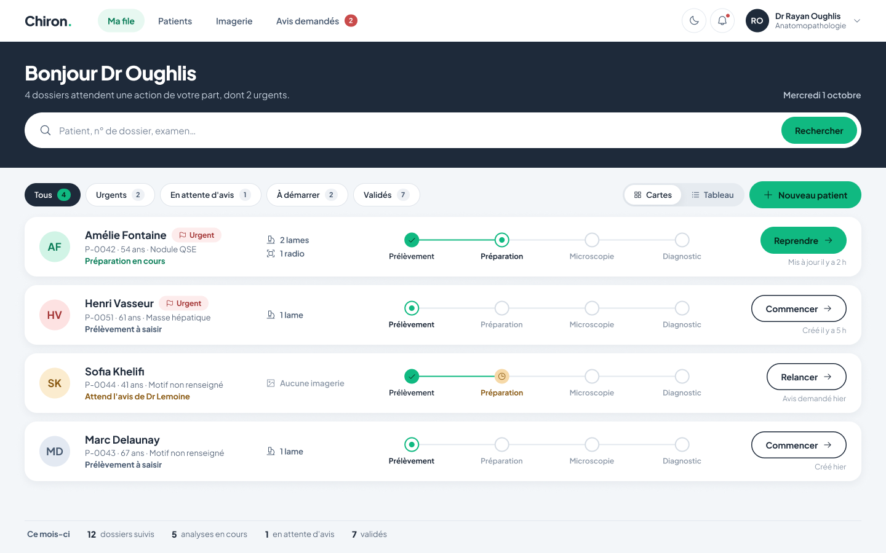

<sub>Maquette de la file de travail : chaque dossier affiche où il en est dans le parcours en quatre étapes et l'action suivante.</sub>

</div>

---

Chiron réunit dans un même dossier patient deux mondes d'imagerie qui ne se
parlent habituellement pas : la **radiologie DICOM** et la **biopsie
numérisée**. S'y ajoutent une aide au diagnostic par segmentation de noyaux
et un compte rendu anatomopathologique guidé par un protocole en quatre
étapes que l'application fait respecter.

> [!WARNING]
> **Projet d'étude.** L'authentification n'est pas implémentée : la
> plateforme ne doit pas héberger de données de patients réels.
> Voir [Sécurité — état réel](#sécurité--état-réel).

> [!TIP]
> **Prise en main complète : [`docs/`](docs/README.md)** — architecture,
> schéma relationnel, conteneurs, endpoints, frontend, librairies, lexique
> médical, pièges et bugs identifiés. Parcours de lecture prévu pour deux jours.
> Une vidéo de présentation est disponible dans
> [`docs/video/chiron-explainer.mp4`](docs/video/chiron-explainer.mp4).

## Sommaire

- [En bref](#en-bref)
- [Fonctionnalités](#fonctionnalités)
- [Maquettes de la refonte](#maquettes-de-la-refonte)
- [Architecture](#architecture)
- [Démarrage rapide](#démarrage-rapide)
- [Workflow OLGA](#workflow-olga)
- [Base de données et migrations](#base-de-données-et-migrations)
- [Développement au quotidien](#développement-au-quotidien)
- [API](#api)
- [Structure du dépôt](#structure-du-dépôt)
- [Sécurité — état réel](#sécurité--état-réel)
- [Dépannage](#dépannage)

---

## En bref

| | |
|---|---|
| 🩻 **Radiologie** | Import DICOM vers Orthanc, visionneuse Cornerstone.js à huit outils, compte rendu exportable en PDF |
| 🔬 **Biopsie** | Lames de plusieurs gigaoctets découpées en tuiles DZI, affichées par OpenSeadragon, annotation collaborative |
| 🧠 **Aide au diagnostic** | Segmentation des noyaux par InstanSeg : densité cellulaire, taille moyenne, indice de pléomorphisme |
| 📋 **Compte rendu** | Quatre étapes ordonnées (Prélèvement → Préparation → Microscopie → Diagnostic), formulaires fournis par OLGA |
| 🐳 **Déploiement** | Sept conteneurs, une seule commande : `docker compose up -d --build` |

---

## Fonctionnalités

### Radiologie — imagerie DICOM

Import d'un fichier `.dcm` depuis l'interface : le backend le relaie à
**Orthanc**, qui l'indexe, puis lit les métadonnées réelles (modalité au
niveau de la série, date et description au niveau de l'étude). Rien n'est
saisi à la main.

La visionneuse **Cornerstone.js** offre huit outils : fenêtrage, déplacement,
zoom, mesure de distance, régions rectangulaire et elliptique, annotation
fléchée et gomme. Le compte rendu se saisit en regard de l'image, avec les
annotations, et s'exporte en PDF.

### Biopsie — lames numérisées

Une lame pèse de 100 Mo à plusieurs gigaoctets : impossible à charger dans un
navigateur. À l'import, Chiron range le fichier source dans **MinIO** puis
génère une **pyramide de tuiles DZI** avec PyVips, servie à la demande selon
le niveau de zoom par **OpenSeadragon**.

> [!NOTE]
> **La conversion est entièrement automatique — aucune commande à lancer.**
> Elle a lieu à l'import depuis l'interface, et au démarrage des conteneurs :
> le service `image_seeder` vérifie à chaque lancement que chaque lame
> enregistrée possède bien ses tuiles, et régénère celles qui manquent depuis
> la lame source conservée dans MinIO.

**Un dossier ne porte qu'une lame et qu'un examen radiologique.** Tout le
reste de l'application travaille sur la première de chaque type ; accepter la
seconde donnait l'illusion d'un import réussi alors qu'elle restait invisible.
Un second import est donc refusé, avec un message qui explique quoi supprimer.
Chaque élément se retire indépendamment depuis la carte patient.

> Un examen DICOM ne peut appartenir qu'à un seul dossier. Orthanc dédoublonne
> par UID : réimporter le même fichier sur un autre patient est refusé, en
> nommant le dossier qui le détient déjà. Détachez-le d'abord.

Annotation collaborative sur un calque SVG : rectangles, cercles, polygones et
libellés. Chaque tracé porte son auteur — vert pour les vôtres, orange pour
ceux des collègues. Une région encadrée devient une **extraction** : elle est
découpée en TIFF pyramidal et constitue un dossier d'analyse autonome.

### Aide au diagnostic

Le service **InstanSeg** (modèle spécialisé en histologie) segmente les noyaux
de la région sélectionnée, bornée à 1500 × 1500 pixels. Il restitue les
contours, superposés à la lame, ainsi que trois indicateurs : densité
cellulaire, taille moyenne des noyaux et indice de pléomorphisme.

Ces valeurs sont une **aide à la lecture**. Le diagnostic reste posé par le
praticien, qui seul valide l'étape correspondante.

### Compte rendu protocolaire

Quatre étapes ordonnées — Prélèvement, Préparation, Microscopie, Diagnostic —
dont les formulaires proviennent d'**OLGA**, un service externe. Le moteur
d'étapes vit côté serveur et garantit que :

- une étape ne peut être validée que si toutes celles qui la précèdent le sont ;
- la progression avance d'un cran à la fois, sans saut possible ;
- chaque validation enregistre son auteur et son horodatage ;
- une saisie partielle peut être conservée en brouillon sans franchir l'étape ;
- rouvrir un dossier le repositionne sur l'étape atteinte.

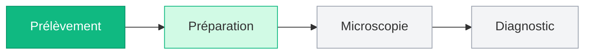

---

## Maquettes de la refonte

L'interface est en cours de refonte. Les planches ci-dessous, conçues sur
[Figma](https://www.figma.com/design/gBD5g3R5rBFOSJNdjiNc8d/Chiron.-Refonte---Directions-de-style?node-id=9-3),
fixent la cible : un seul style (« Accueil »), l'avancement en quatre étapes
visible partout, des visionneuses sans barre de navigation pour laisser tout
l'écran à l'image. Aucune donnée clinique réelle n'y figure.

> [!NOTE]
> Ces écrans décrivent **la cible**, pas l'état actuel du code. Certains
> reposent sur des fonctionnalités encore au backlog
> ([`docs/12-backlog-refonte.md`](docs/12-backlog-refonte.md)) — notamment
> l'authentification, la comparaison de lames et le second avis.

### Le système

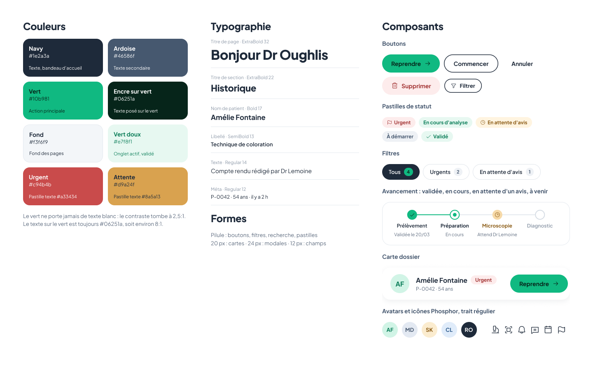

Plus Jakarta Sans partout, formes en pilule pour tout ce qui se clique, cartes
à 20 px de rayon, texte toujours sombre sur le vert.

### Parcours principal

<table>
  <tr>
    <td width="50%" valign="top">
      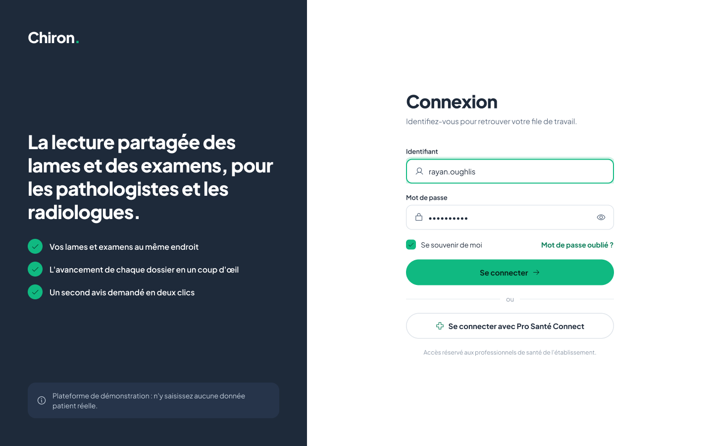
      <p><b>01 · Connexion</b><br>Rassurer et orienter dès la première seconde. Suppose qu'une vraie authentification soit ajoutée avant toute donnée réelle.</p>
    </td>
    <td width="50%" valign="top">
      
      <p><b>02 · File de travail, vue cartes</b><br>Le bandeau dit quoi faire, la recherche est au premier plan, chaque carte montre l'étape atteinte et l'action suivante.</p>
    </td>
  </tr>
  <tr>
    <td width="50%" valign="top">
      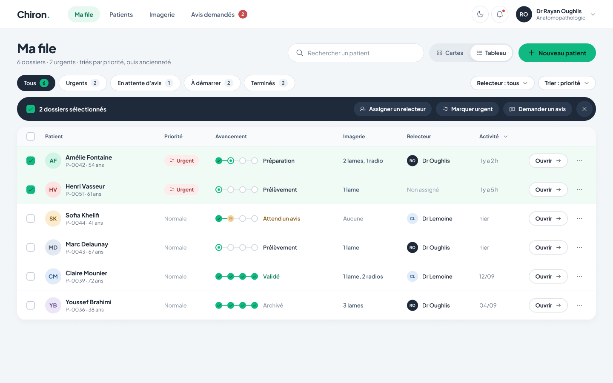
      <p><b>03 · File de travail, vue tableau</b><br>La même file pour le volume : mêmes filtres, plus de lignes, actions groupées sur la sélection multiple.</p>
    </td>
    <td width="50%" valign="top">
      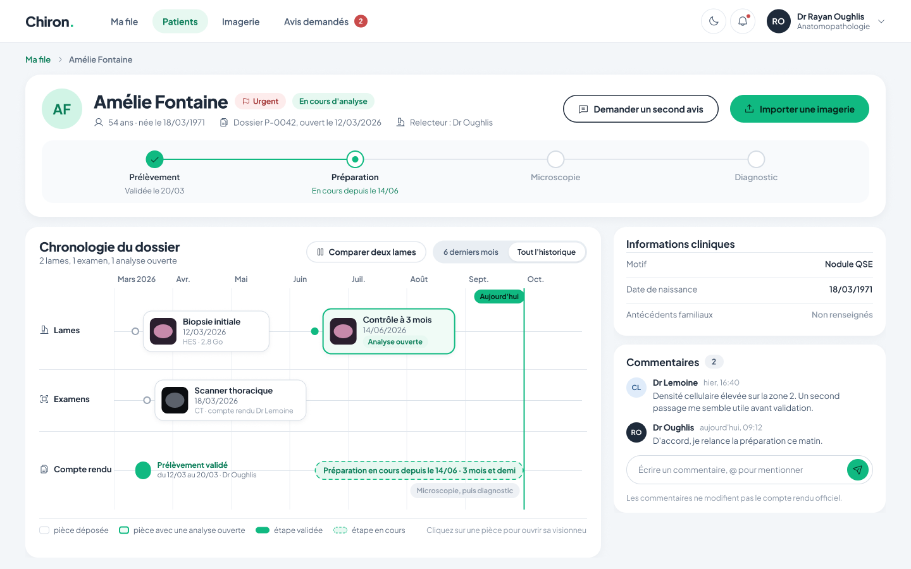
      <p><b>04 · Fiche patient</b><br>Une frise sur un vrai axe de temps : chaque lame et chaque examen posés à leur date, la durée de chaque étape du compte rendu.</p>
    </td>
  </tr>
</table>

### Visionneuses

<table>
  <tr>
    <td width="50%" valign="top">
      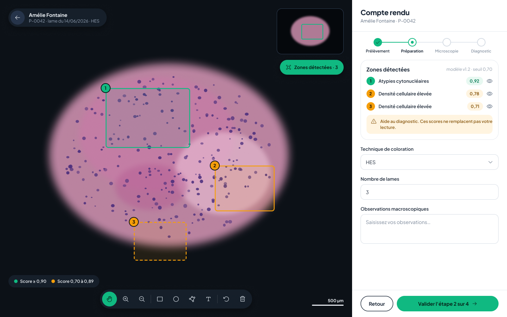
      <p><b>05 · Visionneuse de lame</b><br>L'écran appartient à l'image. Les zones détectées par le modèle sont numérotées et listées avec leur score, présenté comme aide au diagnostic.</p>
    </td>
    <td width="50%" valign="top">
      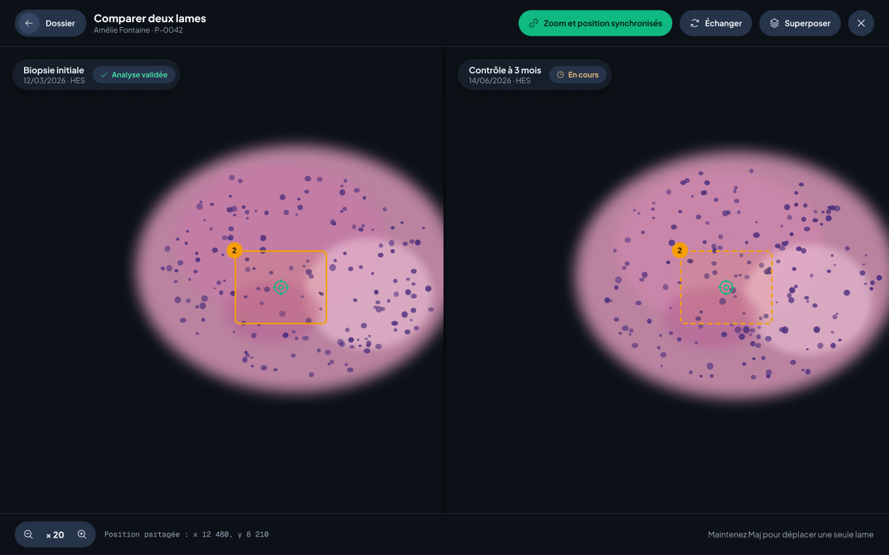
      <p><b>06 · Comparaison côte à côte</b><br>Deux lames du même patient, zoom et position synchronisés. Le réticule montre le même point sur les deux.</p>
    </td>
  </tr>
  <tr>
    <td width="50%" valign="top">
      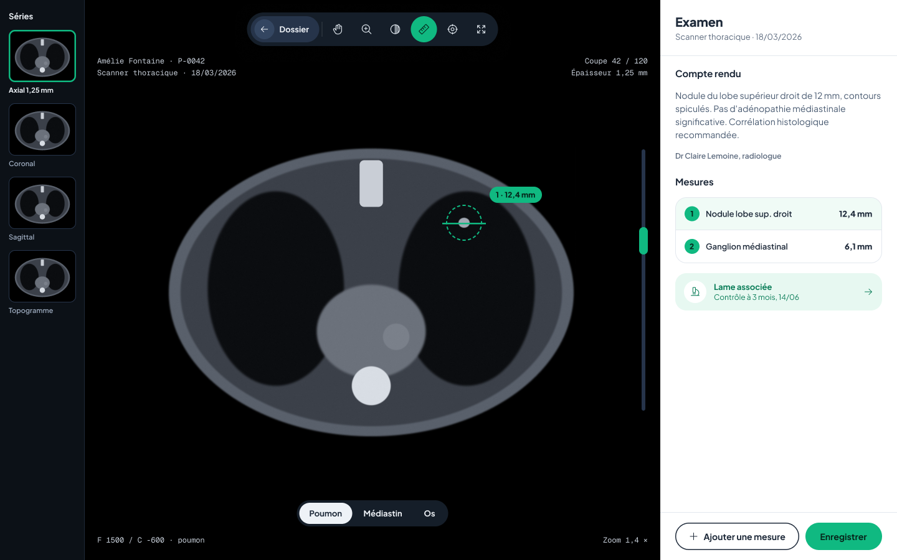
      <p><b>07 · Visionneuse radiologique</b><br>Séries à gauche, coupe au centre avec les repères usuels, compte rendu et mesures à droite.</p>
    </td>
    <td width="50%" valign="top">
      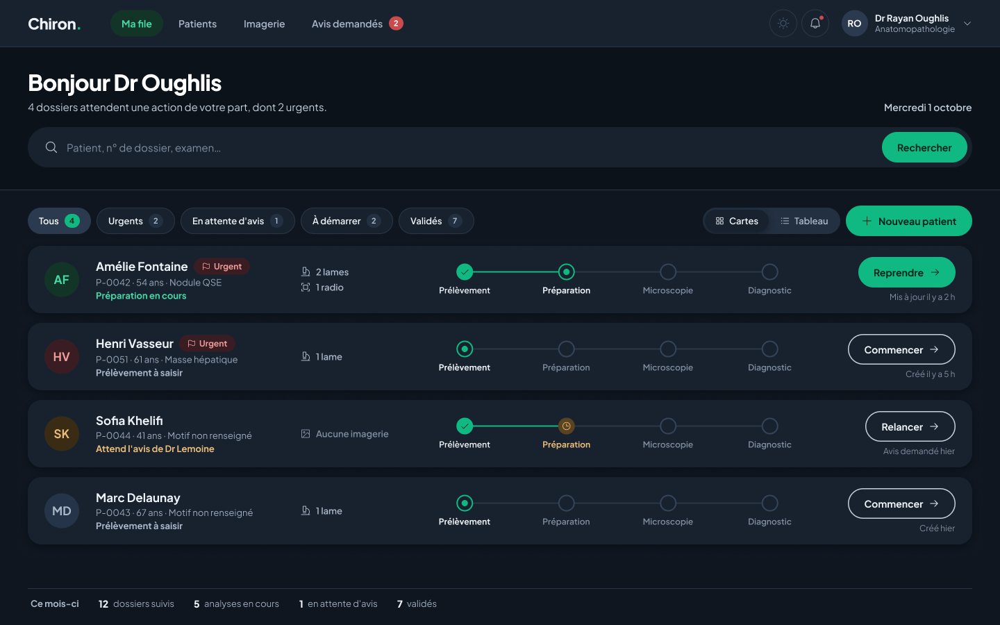
      <p><b>12 · Thème sombre</b><br>Mêmes rôles de couleur. Le vert d'action ne change pas, les pastilles s'éclaircissent pour garder le contraste.</p>
    </td>
  </tr>
</table>

### Modales, notifications et états

<table>
  <tr>
    <td width="50%" valign="top">
      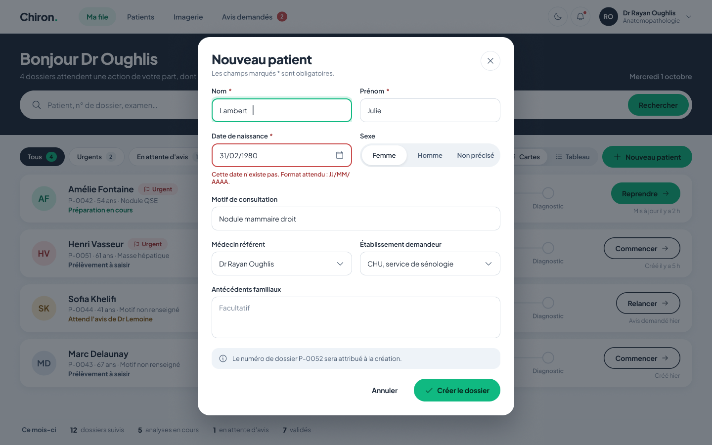
      <p><b>08 · Nouveau patient</b><br>Un formulaire court en deux colonnes, avec les états qu'on oublie : champ actif, erreur expliquée, numéro de dossier annoncé.</p>
    </td>
    <td width="50%" valign="top">
      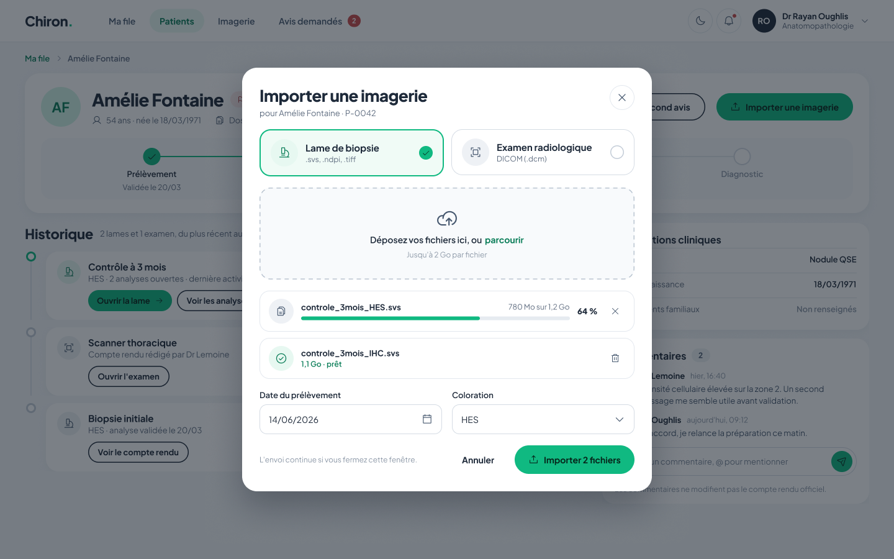
      <p><b>09 · Importer une imagerie</b><br>Le type d'abord, puis le dépôt. Chaque fichier montre sa progression, son poids et son état. Les formats acceptés sont écrits avant.</p>
    </td>
  </tr>
  <tr>
    <td width="50%" valign="top">
      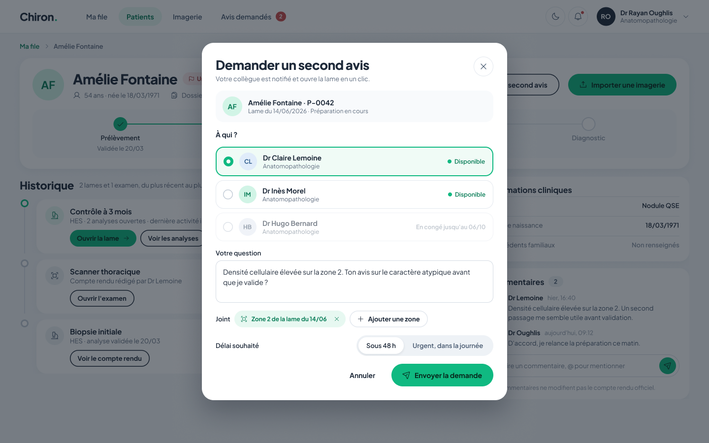
      <p><b>10 · Demande de second avis</b><br>Un collègue disponible, une question, la zone concernée jointe. Le collègue absent reste visible mais grisé.</p>
    </td>
    <td width="50%" valign="top">
      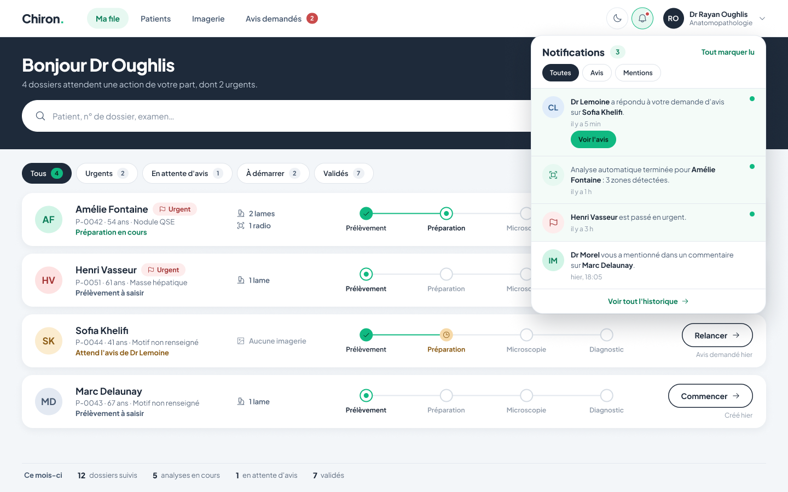
      <p><b>11 · Notifications</b><br>Le panneau s'ouvre sous la cloche, sans quitter la file. Chaque notification propose l'action qui suit.</p>
    </td>
  </tr>
</table>

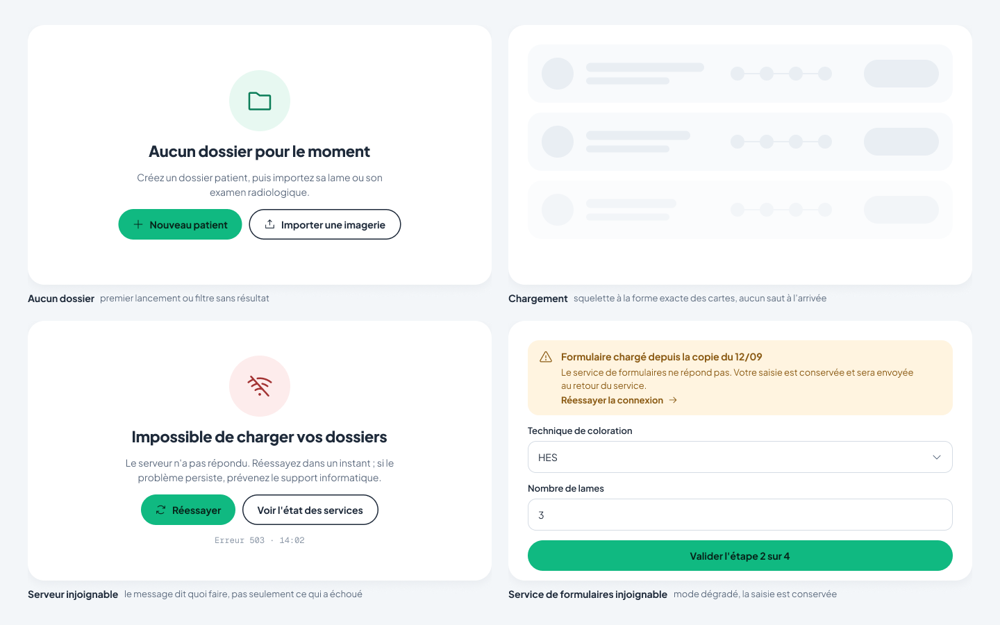

**13 · États transversaux** — le vide invite à agir, le chargement occupe la
place exacte du contenu à venir, l'erreur dit ce qui a échoué et quoi faire,
le mode dégradé conserve la saisie.

---

## Architecture

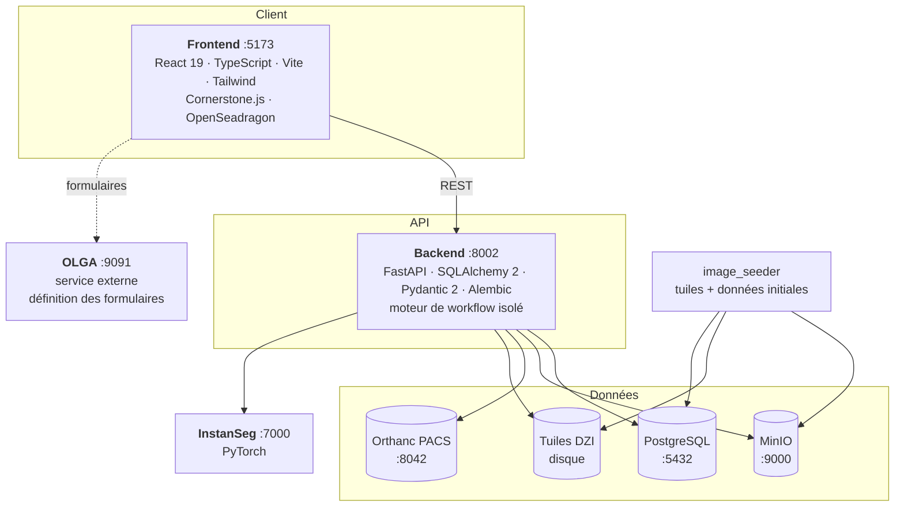

Sept conteneurs : `postgres`, `minio`, `orthanc`, `backend`, `instanseg`,
`frontend`, `image_seeder`.

### Choix structurants

| Décision | Raison |
|---|---|
| Le moteur d'étapes vit chez Chiron, pas chez OLGA | Les données de santé restent dans la base de l'établissement et gardent leur lien au dossier patient. |
| OLGA ne fournit que la définition des formulaires | Son format propriétaire est traduit en JSON Schema par une couche anti-corruption unique. |
| Le suivi du workflow occupe deux tables dédiées | Les données de chaque étape sont en JSONB : un champ ajouté côté OLGA est conservé même sans colonne correspondante. |
| InstanSeg est un service séparé | Évite d'embarquer PyTorch dans l'API métier — image du backend réduite de 15 Go à 1,7 Go. |

---

## Démarrage rapide

### Prérequis

- Docker Desktop (Compose v2)
- 8 Go de RAM, et de l'espace disque pour les tuiles et les modèles

### Lancement

```bash
git clone https://github.com/NEXUS-AI-Innovation-lab/Chiron.git
cd Chiron
docker compose up -d --build
```

Le service `image_seeder` fait deux choses, dans cet ordre :

1. **À chaque démarrage** — il vérifie que chaque lame enregistrée en base
   possède ses tuiles DZI, et **régénère celles qui manquent** depuis la lame
   source conservée dans MinIO. Les tuiles ne sont pas versionnées : sans cette
   passe, un dépôt fraîchement cloné puis restauré depuis un dump afficherait
   des visionneuses vides.
2. **Uniquement si la base est vide** — il injecte les images présentes dans
   `backend/images_initiales/`, génère leurs tuiles et crée les dossiers
   patients. Sur une base déjà peuplée, il s'abstient, pour éviter les doublons
   et le retuilage inutile.

Extrait du journal, lorsque des tuiles manquaient :

    --- VERIFICATION DES TUILES ---
    [>] tuiles manquantes pour William-30b14509/CMU-1.dzi
    [+] tuiles regenerees : William-30b14509/CMU-1.dzi
    [=] 1 pyramide(s) DZI regeneree(s)

### Accès

| Service | URL | Identifiants |
|---|---|---|
| Application | http://localhost:5173 | aucun (voir Sécurité) |
| API + Swagger | http://localhost:8002/docs | — |
| Console MinIO | http://localhost:9001 | `minioadmin` / `minioadmin` |
| Orthanc | http://localhost:8042 | `orthanc` / `orthanc` |

Le détail de tous les accès (ports internes, chaîne de connexion PostgreSQL)
est dans [`ACCES.md`](ACCES.md).

### Ajouter vos propres images

Les lames volumineuses ne sont pas versionnées (`.gitignore`). Un clone frais
démarre avec une lame de démonstration et trois examens DICOM anonymisés. Pour
en ajouter, **avant** le premier démarrage :

```text
backend/images_initiales/
├── biopsie/       # .svs, .tif, .tiff
└── radiologie/    # .dcm
```

Une fois la base peuplée, passez plutôt par l'interface : **Importer une
image**. Le tuilage se fait de la même façon.

---

## Workflow OLGA

Les quatre formulaires du parcours sont hébergés par **OLGA**, consulté
directement sur le port **9091**. Chiron lit la définition des champs, et rien
de plus.

```bash
# Stack OLGA, dans son propre dépôt
docker pull kirito140/olga-backend:latest
docker compose up -d
```

Le registre des étapes — identifiant de chaque formulaire OLGA — vit dans
[`frontend/src/features/workflow/steps.ts`](frontend/src/features/workflow/steps.ts).
C'est le seul endroit à modifier si un formulaire est recréé côté OLGA.

### Traduction en JSON Schema

[`olga/olgaAdapter.ts`](frontend/src/features/workflow/olga/olgaAdapter.ts) est
le **seul fichier du dépôt qui connaît le format d'OLGA**. Il traduit chaque
formulaire en JSON Schema, extrait le code technique du libellé
(`"canalaire (Carcinome canalaire)"` → valeur `canalaire`), et signale à
l'écran les types de champs qu'il ne sait pas rendre au lieu de les masquer.

### Si OLGA est indisponible

Les schémas convertis sont enregistrés dans le dépôt sous forme d'instantanés
versionnés. L'application les sert, l'indique par un bandeau, et **la saisie
reste possible**.

```bash
cd frontend && npm run olga:schemas   # régénère les instantanés
```

Le script réutilise exactement l'adaptateur de l'application : aucune logique
de conversion n'est dupliquée.

---

## Base de données et migrations

Sept tables métier, gérées par **Alembic**, appliqué automatiquement au
démarrage du backend.

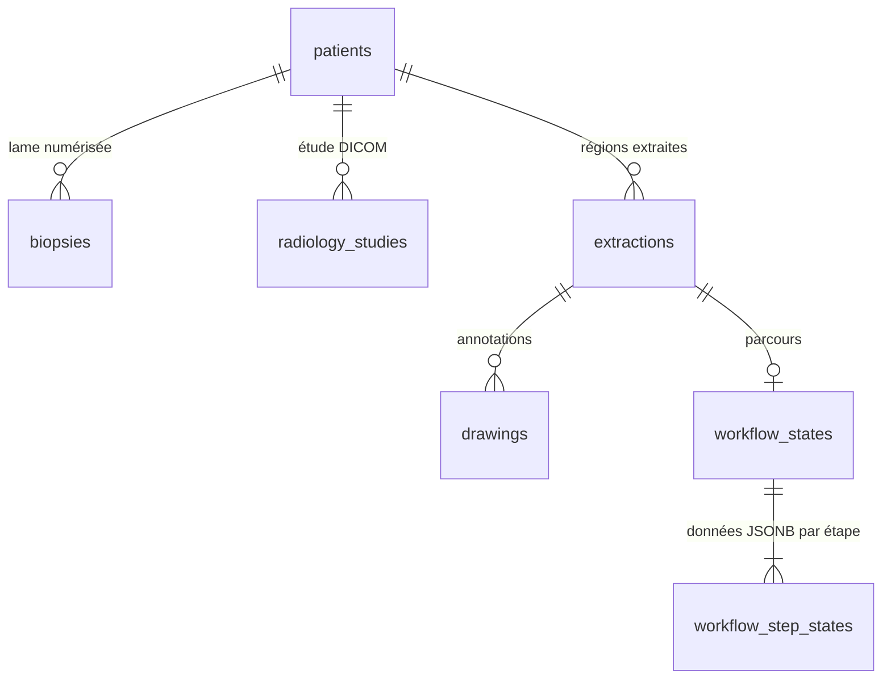

> [!IMPORTANT]
> La création automatique des tables (`create_all`) n'est plus utilisée : elle
> créait les tables absentes mais **n'ajoutait jamais de colonne** à une table
> existante, ce qui cassait silencieusement les bases déjà déployées.

Après toute modification de `backend/models.py` :

```bash
docker exec p6_backend sh -c 'cd /app && alembic revision --autogenerate -m "description"'
docker compose restart backend      # applique la migration
docker exec p6_backend sh -c 'cd /app && alembic current'
```

Pour tester une migration sans toucher aux données de travail, `ALEMBIC_URL`
permet de viser une base jetable.

---

## Développement au quotidien

Le code est monté en volume : les modifications sont prises en compte à chaud
côté frontend, et au redémarrage du conteneur côté backend.

```bash
docker compose logs -f backend      # journaux
docker compose restart backend      # après modification Python

cd frontend
npm run lint                        # analyse statique
npm run build                       # compilation de production (type-check inclus)
npm run olga:schemas                # régénère les instantanés de formulaires
```

### Conventions

- **Configuration par l'environnement.** Les valeurs en dur ne servent que de
  repli pour un lancement hors conteneur. `DATABASE_URL`, `VITE_API_URL` et
  `VITE_OLGA_API_URL` priment.
- **Aucune donnée inventée.** Une valeur absente s'affiche « non renseigné »,
  jamais une valeur plausible générée. Sur un dossier patient, une donnée
  fabriquée est indiscernable d'une donnée réelle.
- **Les erreurs se voient.** Pas de `catch` vide, pas de message générique :
  le détail renvoyé par le serveur est affiché à l'utilisateur.
- **Le nouveau code va dans les modules dédiés** (`backend/workflow/`,
  `frontend/src/features/`), pas dans les fichiers historiques.

### Variables d'environnement

| Variable | Service | Rôle |
|---|---|---|
| `DATABASE_URL` | backend | Connexion PostgreSQL |
| `MINIO_ACCESS_KEY` / `MINIO_SECRET_KEY` | backend | Stockage objet |
| `VITE_API_URL` | frontend | Adresse de l'API |
| `VITE_OLGA_API_URL` | frontend | Service de formulaires |
| `SEED_BASE_DIR` / `DZI_FOLDER` | seeder | Chemins, utiles pour les tests |
| `ALEMBIC_URL` | migrations | Cible une base autre que celle de travail |

---

## API

Documentation interactive : **http://localhost:8002/docs**

### Patients et images

| Méthode | Route | Rôle |
|---|---|---|
| `GET` | `/patients` | Liste des dossiers |
| `POST` | `/patients` | Création |
| `DELETE` | `/patients/{id}` | Suppression du dossier et de ses fichiers |
| `POST` | `/patients/{id}/upload-biopsy` | Import d'une lame + tuilage DZI |
| `POST` | `/patients/{id}/upload-radiology` | Import DICOM vers Orthanc |
| `DELETE` | `/biopsies/{id}` | Retire la lame : objet source, tuiles, ligne |
| `DELETE` | `/radiology-studies/{id}` | Détache l'examen du dossier (Orthanc conservé) |

### Analyse et annotations

| Méthode | Route | Rôle |
|---|---|---|
| `POST` | `/analyze-ai` | Segmentation des noyaux d'une région |
| `POST` | `/extract-roi` | Création d'une extraction |
| `POST` | `/annotations/save` | Enregistrement des annotations |
| `GET` | `/patients/{folder_id}/extractions` | Extractions d'un dossier |
| `GET` | `/extractions/{id}/details` | Détail d'une extraction |
| `DELETE` | `/extractions/{id}` | Suppression |

### Workflow

| Méthode | Route | Rôle |
|---|---|---|
| `GET` | `/extractions/{id}/workflow` | Avancement complet |
| `PUT` | `/extractions/{id}/workflow/steps/{step}` | Enregistre une étape |
| `POST` | `/extractions/{id}/workflow/goto` | Revient sur une étape atteinte |

Refus explicites : `409` si la transition est interdite, `422` si un champ
obligatoire manque, `404` si l'étape est inconnue.

### Divers

`GET /health` interroge réellement chaque dépendance et renvoie `503` avec
l'erreur exacte si l'une d'elles est indisponible.

---

## Structure du dépôt

```
backend/
├── main.py                 API historique (patients, images, IA, extractions)
├── models.py               Modèles SQLAlchemy
├── database.py             Connexion, session
├── storage.py              Résolution des lames dans MinIO (partagé)
├── instanseg_client.py     Client HTTP du service d'IA
├── seed_images.py          Régénération des tuiles + injection initiale
├── workflow/               Moteur d'étapes — structure cible
│   ├── router.py           Routes HTTP
│   ├── service.py          Machine à états, règles de transition
│   ├── schemas.py          Contrats Pydantic
│   └── constants.py        Étapes et projection vers les colonnes
├── alembic/                Migrations
└── images_initiales/       Images de démonstration

frontend/src/
├── pages/                  Dashboard, Viewer (biopsie), RadiologyViewer, Login
├── components/             Carte patient, modales
├── services/api.ts         Client HTTP
├── features/workflow/      Module workflow — structure cible
│   ├── steps.ts            Registre des quatre étapes
│   ├── useWorkflow.ts      État serveur du parcours
│   ├── useOlgaForm.ts      Chargement du formulaire courant
│   ├── workflowApi.ts      Client du moteur d'étapes
│   ├── olga/               Frontière OLGA : client, adaptateur, types
│   ├── schemas/            Instantanés JSON Schema versionnés
│   └── components/         Frise d'avancement, rendu de formulaire
└── (frontend/scripts/)     Régénération des instantanés — hors de src/

instanseg/                  Micro-service de segmentation
docs/                       Documentation de prise en main (14 chapitres)
docs/maquettes/             Planches Figma de la refonte
docker-compose.yml          Orchestration des sept conteneurs
```

---

## Sécurité — état réel

Cette section décrit l'état du projet, pas un objectif.

| Point | État |
|---|---|
| Authentification | **Absente.** L'identité vient du stockage local du navigateur et n'est vérifiée par aucun service. |
| Signature des validations | **Falsifiable.** La traçabilité n'a donc pas de valeur médico-légale. |
| Contrôle d'accès par rôle | Absent. Un technicien peut valider l'étape de diagnostic. |
| Accès aux images | Les tuiles sont servies sans contrôle. |
| CORS | Ouvert à toutes les origines. |
| Identifiants des services | Valeurs par défaut, en clair dans le `docker-compose.yml`. |
| Chiffrement | Aucun : les services communiquent en clair sur le réseau conteneurisé. |

> [!CAUTION]
> **Conséquence : ne pas déposer de données de patients réels.**

Prochaine étape prévue : authentification par jeton, rôles (technicien,
pathologiste, radiologue), et contrôle d'accès sur les tuiles.

---

## Dépannage

<details>
<summary><b>« Aucun patient trouvé » ou échec de requête</b></summary>

Vérifiez que `VITE_API_URL` pointe sur `http://localhost:8002` et que le
backend répond : `curl http://localhost:8002/health`.
</details>

<details>
<summary><b>Bandeau « Le service de formulaires OLGA est injoignable »</b></summary>

La stack OLGA n'est pas démarrée. L'application reste utilisable : les
formulaires sont servis depuis les instantanés versionnés.
</details>

<details>
<summary><b>Écran noir en radiologie</b></summary>

L'étude n'est pas dans Orthanc, ou son identifiant ne correspond pas à celui
enregistré. Vérifiez sur http://localhost:8042.
</details>

<details>
<summary><b>« Lame source introuvable dans MinIO »</b></summary>

Le message liste les emplacements essayés. Vérifiez que l'objet existe :
console MinIO, bucket `biopsie`.
</details>

<details>
<summary><b>Le seeder n'injecte rien</b></summary>

L'injection ne s'exécute que sur une base vide — c'est voulu, pour éviter les
doublons. La vérification des tuiles, elle, tourne à chaque démarrage.
Journaux : `docker logs p6_image_seeder`.
</details>

<details>
<summary><b>« Ce dossier contient déjà une lame » / « déjà un examen radiologique »</b></summary>

Un dossier ne porte qu'un élément de chaque type. Retirez l'existant avec le
bouton corbeille placé à côté de « Biopsie » ou « Radio » sur la carte patient,
puis relancez l'import.
</details>

<details>
<summary><b>« Cet examen DICOM est déjà rattaché au dossier de X »</b></summary>

Le même fichier ne peut pas appartenir à deux patients. Détachez-le du dossier
qui le détient, puis importez-le sur le nouveau. Les trois examens de
démonstration sont déjà rattachés aux dossiers créés au premier démarrage.
</details>

<details>
<summary><b>La plateforme devient injoignable pendant un import (<code>ERR_CONNECTION_RESET</code>)</b></summary>

Corrigé : le travail lourd d'un import (envoi vers le stockage objet, tuilage)
s'exécute désormais hors de la boucle d'événements. L'API reste disponible
pendant toute la durée de l'opération, y compris pour une lame de plusieurs
centaines de mégaoctets.
</details>

<details>
<summary><b>Une suppression paraît sans effet, ou semble demander deux clics</b></summary>

Les confirmations passent par une modale de l'application, et non plus par le
dialogue du navigateur, que l'utilisateur pouvait désactiver (« Empêcher cette
page de créer des boîtes de dialogue supplémentaires »), ce qui rendait les
suppressions silencieusement inopérantes. La suppression d'une lame **répond
immédiatement** : les tuiles, plusieurs dizaines de milliers de fichiers, sont
écartées puis effacées en tâche de fond. Si le comportement persiste,
rechargez la page sans cache (Ctrl+Maj+R).
</details>

<details>
<summary><b>Une visionneuse de biopsie reste vide</b></summary>

Les tuiles manquent. Relancez la vérification :
`docker compose up -d --force-recreate image_seeder`, puis suivez
`docker logs -f p6_image_seeder`. Si la régénération échoue, c'est que la lame
source est absente de MinIO — le message le précise.
</details>

<details>
<summary><b>Le backend démarre mais <code>/health</code> renvoie 503</b></summary>

La réponse contient l'erreur exacte du service en cause.
</details>

---

## Licence

Aucune licence n'est encore associée à ce dépôt.
